<div align="center">

# 🛒 Мини-магазин

**Высоконагруженное приложение интернет-магазина — практикум ПМ01**

REST API на FastAPI с базой на 200 000 товаров и 500 000 заказов,
шаг за шагом превращённый в отказоустойчивую систему из 24 контейнеров


</div>

---

## ✨ Что получилось

| | Лаб 1 (старт) | Лаб 8 (финал) | |
|---|---:|---:|---|
| **p95 всех запросов** | 168 мс | **11 мс** | в 15 раз быстрее |
| **p95 оформления заказа** | 235 мс | **23 мс** | в 10 раз быстрее |
| **CPU базы данных** | до 800% | **~5%** | нагрузку забрали кэши и реплики |
| **Предельная нагрузка** | — | **667 RPS** при 300 пользователях | 0 ошибок |
| **Отказ любого узла** | падает всё | **0 ошибок** | воркер, мастер Redis, реплика БД |

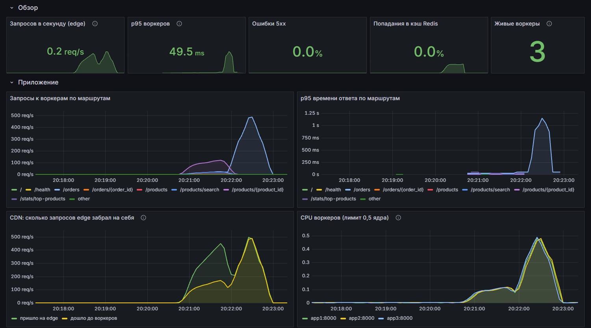

<sub>Дашборд Grafana во время теста: основная нагрузка (20:21–20:22), потом всплеск заказов 300/с. Edge-кэш принимает больше половины запросов, а CPU воркеров не доходит до лимита в 0,5 ядра.</sub>

## 📑 Содержание

- [Архитектура](#-архитектура)
- [Быстрый старт](#-быстрый-старт)
- [Как проходит запрос](#-как-проходит-запрос)
- [Лабораторные работы](#-лабораторные-работы)
- [Результаты замеров](#-результаты-замеров)
- [Опыты с отказами](#-опыты-с-отказами)
- [Подводные камни](#-подводные-камни-и-как-их-обошли)
- [Структура проекта](#-структура-проекта)

---

## 🏗 Архитектура

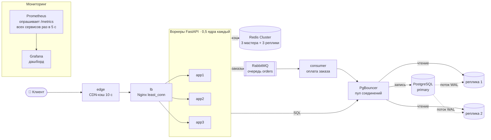

| Компонент | Зачем | Лаба |
|---|---|:---:|
| **FastAPI + asyncpg** | API магазина; асинхронность — один процесс держит сотни соединений | 1 |
| **Nginx (lb)** | раздаёт запросы трём воркерам, переживает падение любого | 2 |
| **Redis Cluster** | кэш горячих данных; 6 узлов — шардирование и автоматический failover | 3–4 |
| **RabbitMQ + consumer** | медленная оплата вынесена из запроса пользователя | 5 |
| **PostgreSQL primary + 2 реплики** | запись на primary, чтение — с реплик | 6 |
| **PgBouncer** | тысячи клиентских соединений → десятки настоящих | 7 |
| **Edge (Nginx proxy_cache)** | модель CDN: одинаковые ответы отдаются, не доходя до приложения | 8 |
| **Prometheus + Grafana** | метрики всех сервисов и дашборд | 8 |

---

## 🚀 Быстрый старт

Нужен **Docker Desktop** (Docker выделить не меньше 5 ГБ памяти).

```powershell
git clone https://github.com/MarFaus/shop_pm01_home.git shop
cd shop
docker compose up -d --build
docker compose ps
```

> [!NOTE]
> Первый запуск идёт 1–2 минуты: Docker скачивает образы, грузит 700 000 строк в базу и копирует её на реплики.
> Всё готово, когда `postgres`, реплики и `rabbitmq` в статусе `healthy`, остальные — `Up`.
> `redis-init` и `db-migrate` в статусе `Exited (0)` — это одноразовые контейнеры, так и должно быть.

| Что | Адрес | Вход |
|---|---|---|
| 🛍 **Витрина магазина** | http://localhost:8080/shop/ | — |
| 🛒 API магазина (через edge-кэш) | http://localhost:8080 | — |
| 📖 Swagger — все методы API | http://localhost:8080/docs | — |
| ⚖️ Балансировщик в обход кэша | http://localhost:8081 | — |
| 📊 Grafana, дашборд «Мини-магазин» | http://localhost:3000 | без входа · `admin` / `admin` |
| 🔥 Prometheus | http://localhost:9090/targets | — |
| 🐰 RabbitMQ | http://localhost:15672 | `shop` / `shop` |

### 🛍 Витрина

Страница для людей поверх того же API: хиты недели, 50 категорий, поиск, карточка товара и покупка.
После покупки видно, как заказ проходит очередь: «принят» → «оплачен» (consumer, ~0,2 с).
Внизу — **журнал запросов**: на каждый запрос страницы видно, ответил ли edge-кэш, какой воркер
обработал запрос и было ли попадание в Redis. Это наглядная демонстрация лаб 2, 3, 5 и 8.

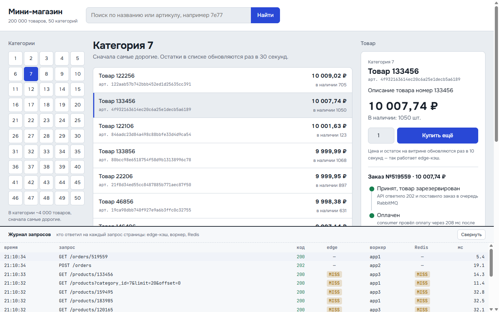

Файл — [`web/index.html`](web/index.html) (один статический файл без сборки), отдаёт его edge-nginx.
Нагрузочный тест витрину не трогает.

```powershell
docker compose down      # остановить, данные сохранятся
docker compose down -v   # остановить и удалить базы, очереди, метрики
```

<details>
<summary>📖 Swagger: все методы API</summary>

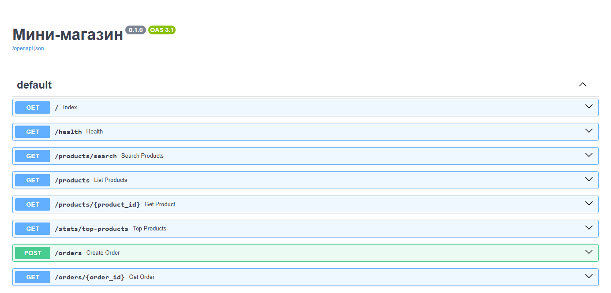

| Метод | Что делает | Откуда данные |
|---|---|---|
| `GET /products/{id}` | карточка товара | Redis → primary |
| `GET /products?category_id=` | товары категории, сначала дорогие | Redis → реплика |
| `GET /products/search?q=` | поиск по названию | Redis → реплика |
| `GET /stats/top-products` | топ-10 продаж за неделю | Redis → реплика |
| `POST /orders` | заказ: резерв товара + очередь на оплату, ответ `202` | primary + RabbitMQ |
| `GET /orders/{id}` | заказ по номеру (`pending` → `processed`) | primary |
| `GET /health` | состояние воркера, кэша и реплик | — |

</details>

---

## 🔀 Как проходит запрос

**Просмотр товара** — чем раньше найден ответ, тем быстрее:

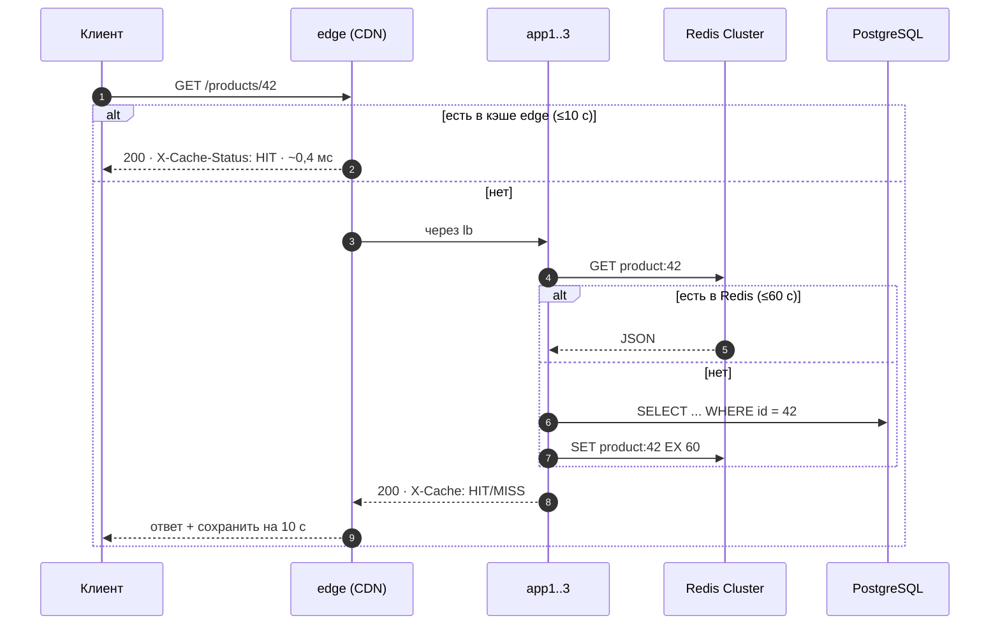

**Заказ** — пользователь не ждёт медленный платёжный шлюз:

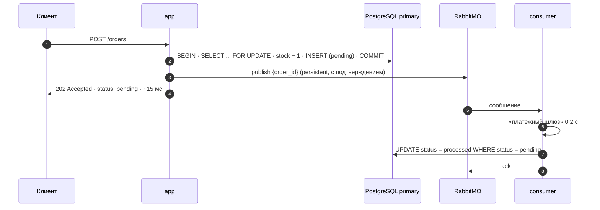

Пример ответа: заголовки показывают оба уровня кэша и воркер, который обработал запрос.

```http
HTTP/1.1 200 OK
x-cache: MISS                ← Redis в приложении (лаб 3)
x-instance: app2             ← какой воркер ответил (лаб 2)
X-Upstream: 172.18.0.21:8000 ← адрес воркера от балансировщика
X-Cache-Status: HIT          ← edge-кэш (лаб 8): этот ответ отдал edge
```

---

## 🧪 Лабораторные работы

Каждая лаба — отдельный коммит с тегом. Код на любом этапе: `git checkout lab-3`. Что изменилось за лабу: `git diff lab-2 lab-3`.

<details>
<summary><b>Лаб 0 · Подготовка</b> — структура проекта и git</summary>

`.gitignore` и `.gitattributes`. Второй файл важен на Windows: он заставляет git хранить `.sh`, `.conf` и `.sql` с переводами строк LF. Иначе скрипты внутри Linux-контейнеров падают с ошибкой `/bin/sh^M`.

</details>

<details>
<summary><b>Лаб 1 · Приложение и БД</b> — FastAPI + PostgreSQL в Docker, первый замер</summary>

**Сделано:** API магазина (`app/main.py`), схема и тестовые данные (`db/init/01_schema.sql`), Dockerfile, compose, нагрузочный тест `k6/load.js`. Сделано и задание «Сделайте сами» — `GET /orders/{id}`.

В коде три намеренно «тяжёлых» места:

| Место | Почему медленно | Чем вылечено |
|---|---|---|
| `GET /products/search` | `ILIKE '%...%'` перебирает все 200 000 товаров | кэш (3), GIN-индекс (7) |
| `GET /stats/top-products` | агрегация по 500 000 заказов | кэш (3), индекс `INCLUDE` (7) |
| `POST /orders` | ждёт «платёжный шлюз» 0,2 с | очередь (5) |

**Результат:** 239 RPS, p95 168 мс. Узкое место — **postgres, до 800% CPU**.

</details>

<details>
<summary><b>Лаб 2 · Балансировщик</b> — Nginx + 3 воркера</summary>

**Сделано:** `nginx/default.conf` и три воркера через YAML-якорь `&app`.

- `least_conn` — новый запрос отдаётся наименее занятому воркеру. Запросы у нас очень разные: 3 мс у карточки и 200 мс у заказа.
- `proxy_next_upstream` — если воркер упал, GET повторяется на другом. POST не повторяется: иначе можно создать заказ дважды.
- `zone` + `resolve` — nginx замечает новый IP пересозданного контейнера (см. [подводные камни](#-подводные-камни-и-как-их-обошли)).

**Результат:** нагрузка на каждый воркер упала с 50% до ~21% CPU. Остановка `app2` под нагрузкой — **0 ошибок**.

</details>

<details>
<summary><b>Лаб 3 · Кэш Redis</b> — cache-aside, TTL, инвалидация</summary>

**Сделано:** `app/cache.py`. Схема cache-aside: ищем в Redis → не нашли — берём из БД и кладём с TTL → данные изменились — удаляем ключ.

| Ключ | TTL | Инвалидация |
|---|---|---|
| `product:{id}` | 60 с | удаляется после заказа (остаток изменился) |
| `list:{cat}:{limit}:{offset}` | 30 с | только TTL |
| `search:{q}:{limit}` | 60 с | только TTL |
| `stats:top` | 30 с | только TTL |

Если Redis недоступен, магазин работает напрямую с БД: кэш ускоряет, но не хранит данные.

**Результат:** CPU postgres упал **с 780% до 30%**, медиана ответа — 1,9 мс.

</details>

<details>
<summary><b>Лаб 4 · Redis Cluster</b> — 6 узлов, шардирование, failover</summary>

**Сделано:** `redis/redis.conf` и `redis/cluster-init.sh`. Ключи делятся между мастерами по слотам: `CRC16(ключ) mod 16384`.

```
redis1 master 0-5460        redis4 slave
redis2 master 5461-10922    redis5 slave
redis3 master 10923-16383   redis6 slave
```

**Опыт:** мастер остановили под нагрузкой. Через 5 с его реплика стала мастером, а вернувшийся узел встал репликой. **0 ошибок.** Чтобы пользователь не ждал переключения, на любую операцию с кэшем стоит потолок 0,3 с.

</details>

<details>
<summary><b>Лаб 5 · RabbitMQ</b> — асинхронная обработка заказов</summary>

**Сделано:** `app/mq.py`, `app/consumer.py`, `rabbitmq/limits.conf`, тест всплеска `k6/orders.js`.

Чтобы заказ не потерялся:
- очередь `durable`, сообщения `persistent`, `publisher_confirms`;
- публикация — **после** коммита, ack — только после записи в БД;
- `UPDATE ... WHERE status = 'pending'` — повторное сообщение ничего не испортит (идемпотентность);
- ошибочные сообщения уходят в `orders.dead`, а не крутятся по кругу;
- страховка: consumer переотправляет заказы, «застрявшие» в `pending`.

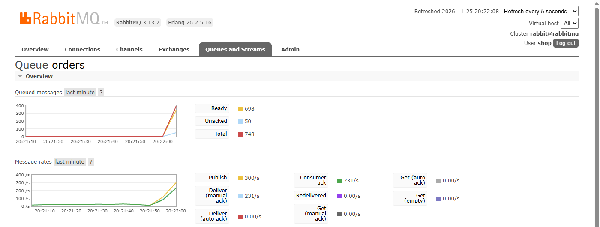

<sub>Всплеск 300 заказов/с: API публикует 300 сообщений/с, consumer обрабатывает ~230/с, и очередь копит разницу. После пика она разбирается за секунды.</sub>

**Результат:** p95 заказа **упал с 210 до 25 мс**, общий p95 — с 205 до 11 мс.

</details>

<details>
<summary><b>Лаб 6 · Реплики PostgreSQL</b> — чтение с реплик, запись в primary</summary>

**Сделано:** `db/init/02_replication.sh`, `db/replica-entrypoint.sh`, `app/db.py`.

- Реплика при первом запуске копирует базу (`pg_basebackup`), затем получает изменения потоком WAL.
- **Слоты репликации**: primary не удалит WAL, пока реплика его не получила.
- `app/db.py` читает с реплик по очереди. Если реплика недоступна, запрос уходит на primary, а реплика пропускается 10 с.
- `GET /orders/{id}` и карточка товара при промахе кэша читаются с primary — **read-your-writes**: покупатель сразу видит свой заказ и актуальный остаток.

```
 application_name | state     |     slot_name | active
 walreceiver      | streaming |     replica1  | t
 walreceiver      | streaming |     replica2  | t
```

**Результат:** CPU primary упал до ~5%. Остановка реплики под нагрузкой — **0 ошибок**.

</details>

<details>
<summary><b>Лаб 7 · PgBouncer и тюнинг</b> — пул соединений, postgresql.conf, индексы</summary>

**Сделано:** `pgbouncer/`, `db/conf/postgresql.conf`, `db/init/03_extensions.sql`, `db/sql/indexes.sql`, `explain.sql`, `top_queries.sql`, `k6/stress.js`.

**Индексы** (EXPLAIN ANALYZE до → после):

| Запрос | До | После | Индекс |
|---|---:|---:|---|
| Список категории | 17,2 мс | **0,25 мс** | B-tree `(category_id, price DESC)` |
| Поиск без совпадений | 63,6 мс | **0,56 мс** | GIN по триграммам `pg_trgm` |
| Топ продаж за неделю | 114,6 мс | **42,5 мс** | `(created_at) INCLUDE (product_id, quantity)` → Index Only Scan |

**PgBouncer** в режиме `transaction`: при 300 пользователях к нему подключено 78 клиентов, а к самим базам — 34 соединения.

**Находка через `pg_stat_statements`:** asyncpg после *каждого* запроса слал `RESET ALL; CLOSE ALL; …`. Это лишний сетевой круг, поэтому отключено.

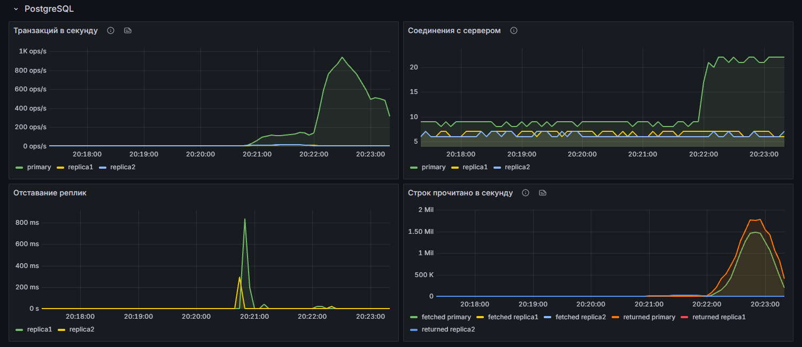

<sub>Транзакции, соединения, отставание реплик и прочитанные строки по каждому серверу.</sub>

</details>

<details>
<summary><b>Лаб 8 · CDN и мониторинг</b> — edge-кэш, Prometheus, Grafana</summary>

**Edge-кэш** (`edge/default.conf`) — модель CDN перед балансировщиком:
- «микрокэш» 10 с только для `/products` и `/stats`: заказы никогда не кэшируются;
- `proxy_cache_lock` — за устаревшим ответом к приложению идёт один запрос, а не сто;
- `proxy_cache_use_stale` — если приложение упало, отдаётся последняя копия.

**Мониторинг:** приложение отдаёт `/metrics` (запросы, гистограмма времени ответа по маршрутам, попадания в кэш, CPU). Экспортеры отдают метрики PostgreSQL, Redis и nginx, у RabbitMQ есть встроенный плагин. Prometheus опрашивает 16 целей раз в 5 с.

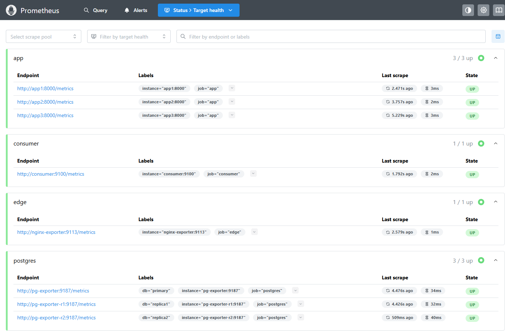

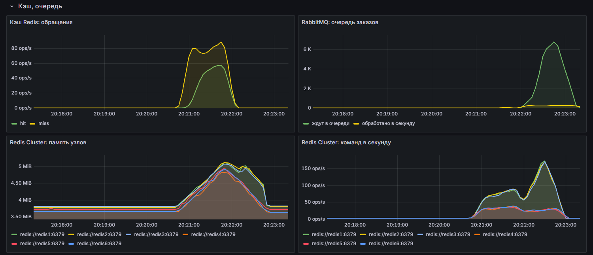

**Результат:** edge принимает ~60% запросов, CPU воркеров упал вдвое, медиана ответа — **0,4 мс**.

</details>

---

## 📈 Результаты замеров

Тест `k6/load.js`: до 50 пользователей, 70 секунд, смесь «обычного дня магазина» — 60% карточек, 20% списков, 10% топа, 5% поиска, 5% заказов.

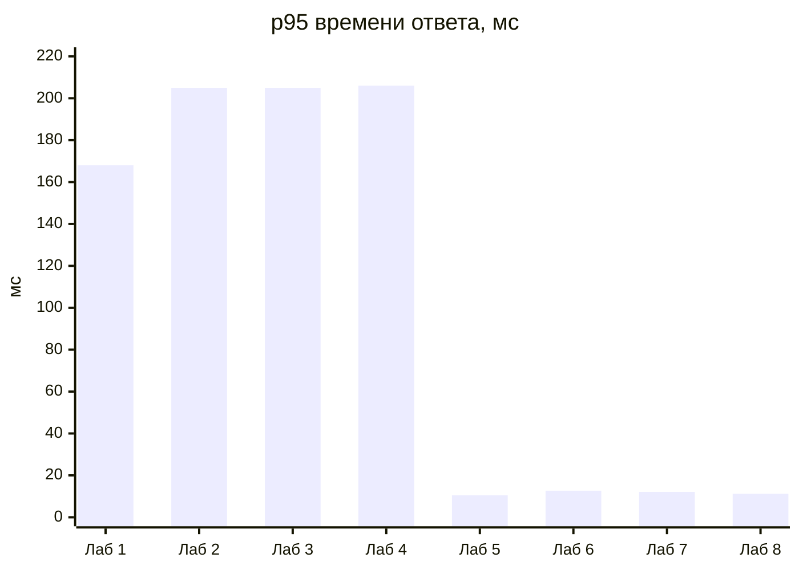

| Лаб | RPS | p95, мс | Ошибки | p95 search | p95 order | Узкое место |
|:---:|---:|---:|---:|---:|---:|---|
| 1 | 238,6 | 168,4 | 0% | 19,4 | 235,2 | postgres (до 800% CPU) |
| 2 | 240,3 | 204,7 | 0% | 13,0 | 216,8 | postgres (до 780% CPU) |
| 3 | 266,3 | 204,6 | 0% | 7,3 | 209,9 | воркеры app; postgres 30% |
| 4 | 261,6 | 205,8 | 0% | 14,1 | 220,6 | воркеры app |
| 5 | 289,2 | **10,5** | 0% | 9,3 | **39,3** | воркеры app |
| 6 | 287,9 | 12,7 | 0% | 10,4 | 24,9 | воркеры app; primary ~5% |
| 7 | 288,6 | 12,1 | 0% | 8,9 | 28,0 | воркеры app; БД почти без нагрузки |
| 8 | 292,6 | 11,2 | 0% | 8,7 | 23,2 | нет — упёрлись в сам тест |

> [!TIP]
> **Почему RPS почти не растёт?** Его ограничивает сам тест: в среднем ~30 пользователей, и каждый после запроса ждёт 0,1 с, то есть больше ~300 RPS не получится при любом сервере. Прогресс видно по p95 и по загрузке CPU. Настоящий предел показывает стресс-тест `k6/stress.js`: **667 RPS** при 300 пользователях.
>
> Почему p95 в лабах 2–4 ~205 мс: 5% запросов — заказы, а они синхронно ждут шлюз 0,2 с. После очереди (лаб 5) это ушло.

Полный журнал с пояснениями — [ЖУРНАЛ.md](ЖУРНАЛ.md), отчёты k6 — в папке [`results/`](results/).

Отчёты по каждой лабе в Word (цель, код, тесты, замеры, ответы на вопросы) — в папке [`docs/report/`](docs/report/).

```powershell
docker compose run --rm k6 run /scripts/load.js     # основной замер (70 с)
docker compose run --rm k6 run /scripts/orders.js   # всплеск заказов (смотреть очередь в RabbitMQ)
docker compose run --rm k6 run /scripts/stress.js   # 300 пользователей
```

---

## 💥 Опыты с отказами

Во время `load.js` останавливаем компонент (`docker compose stop ...`), через 20 с запускаем обратно.

| Что уронили | Что произошло | Ошибок |
|---|---|:---:|
| воркер `app2` | nginx исключил его и повторил GET-запросы на других | **0** из 16 774 |
| мастер Redis `redis5` | через 5 с реплика стала мастером, вернувшийся узел — репликой | **0** из 17 073 |
| реплика `postgres-r1` | чтение ушло на вторую реплику и primary | **0** из 19 569 |
| всплеск 300 заказов/с | очередь выросла и разобралась после пика | **0** |

---

## 🪤 Подводные камни и как их обошли

Это то, что не написано в методичке, но реально случилось при сборке.

| Симптом | Причина | Решение |
|---|---|---|
| После пересоздания воркеров — **502** | nginx запомнил старые IP контейнеров | `resolver 127.0.0.11` + `zone` + `server ... resolve` |
| Отдельные `curl` всегда попадали в app1 | у каждого процесса nginx свой счётчик балансировки | общая `zone` для upstream |
| Запросы висели до **10 с** при failover Redis | клиент кластера долго ретраит | потолок 0,3 с на операцию кэша, потом сразу в БД |
| RabbitMQ ел **150–250% CPU** без нагрузки | healthcheck запускал виртуальную машину Erlang + busy-wait | `nc -z` вместо `rabbitmq-diagnostics`, `+sbwt none` |
| `shop_r2` молча читал из **r1** | PgBouncer закэшировал DNS, а IP реплик поменялись местами | `dns_max_ttl = 2` |
| Запрос ждал **30 с** при упавшей реплике | DNS-поиск остановленного контейнера | таймаут чтения с реплики 1 с → primary |
| В кэш мог попасть **старый остаток** | после заказа ключ удалён, а реплика ещё не получила UPDATE | карточку при промахе читаем с primary |
| На каждый запрос — лишние `RESET ALL; CLOSE ALL` | сброс сессии в пуле asyncpg | `reset=_no_reset` (сессионного состояния нет) |
| Скрипты в контейнере: `/bin/sh^M` | Windows-переводы строк | `.gitattributes` с `eol=lf` |
| В Git Bash `/scripts/load.js` → `C:/Program Files/Git/...` | MSYS подменяет пути | `MSYS_NO_PATHCONV=1` или PowerShell |

Проект проверен с нуля: чистый `git clone` → `docker compose up -d --build` → все проверки по 8 лабам проходят примерно за 90 секунд.

---

## 📁 Структура проекта

```
shop/
├── docker-compose.yml          26 сервисов + k6: вся система в одном файле
├── app/
│   ├── main.py                 API магазина, метрики
│   ├── cache.py                Redis / Redis Cluster, cache-aside
│   ├── db.py                   primary + реплики, переключение при отказе
│   ├── mq.py                   публикация заказов в RabbitMQ
│   ├── consumer.py             обработка заказов из очереди
│   ├── Dockerfile
│   └── requirements.txt        версии закреплены
├── db/
│   ├── init/                   схема + 700 000 строк, репликация, расширения
│   ├── conf/postgresql.conf    память, SSD, репликация, pg_stat_statements
│   ├── sql/                    индексы, EXPLAIN, топ запросов
│   └── replica-entrypoint.sh   запуск реплики через pg_basebackup
├── nginx/default.conf          балансировщик
├── edge/default.conf           CDN-кэш
├── redis/                      конфиг узла и сборка кластера
├── rabbitmq/limits.conf
├── pgbouncer/                  pgbouncer.ini, userlist.txt
├── monitoring/                 prometheus.yml, Grafana: источник + дашборд
├── k6/                         load.js, orders.js, stress.js
├── results/                    отчёты k6, docker stats, планы запросов
├── web/index.html              витрина магазина (/shop/)
├── docs/report/                отчёты по лабам 0–8 (.docx)
├── scripts/smoke.sh            сквозная проверка стенда (26 проверок)
├── ЖУРНАЛ.md                   журнал замеров
└── ОТВЕТЫ.md                   ответы на контрольные вопросы
```

<details>
<summary>🔍 Команды для проверки каждой лабы</summary>

```powershell
# Лаб 1–2: воркеры по очереди (поле instance), 404 для несуществующего заказа
curl.exe http://localhost:8080/
curl.exe http://localhost:8080/orders/999999999

# Лаб 3, 8: X-Cache (Redis) и X-Cache-Status (edge)
curl.exe -i http://localhost:8080/products/42

# Лаб 4: состав кластера
docker compose exec redis1 redis-cli cluster nodes

# Лаб 5: заказ — сразу pending, через 0,2 с processed
curl.exe -X POST http://localhost:8080/orders -H "Content-Type: application/json" -d '{\"product_id\": 5}'

# Лаб 6: реплики и слоты
docker compose exec postgres psql -U shop -d shop -c "SELECT client_addr, state, replay_lag FROM pg_stat_replication"
docker compose exec postgres psql -U shop -d shop -c "SELECT slot_name, active FROM pg_replication_slots"

# Лаб 7: планы запросов, самые тяжёлые запросы, пулы PgBouncer
docker compose exec postgres psql -U shop -d shop -f /sql/explain.sql
docker compose exec postgres-r1 psql -U shop -d shop -f /sql/top_queries.sql
docker compose exec -e PGPASSWORD=shop pgbouncer psql -h 127.0.0.1 -p 6432 -U shop pgbouncer -c "SHOW POOLS"
```

</details>

---

<div align="center">

📊 [Журнал замеров](ЖУРНАЛ.md) · ❓ [Ответы на контрольные вопросы](ОТВЕТЫ.md) · 📁 [Отчёты k6](results/) · 📝 [Отчёты по лабам](docs/report/)

</div>
